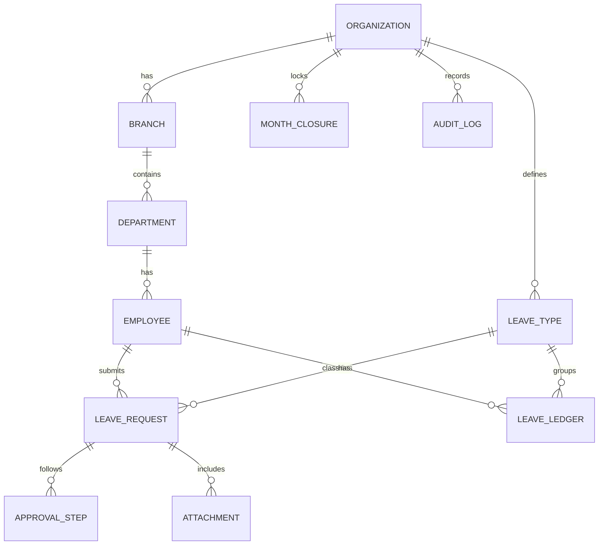

# مسودة المرحلة 0: التأسيس على Neon

هذه خطة للمراجعة، وليست تطبيقاً أو مخطط قاعدة بيانات منفذاً. يُحفظ المصدر الأصلي كما هو مع ملاحظة التحديث، والمواصفات الحالية في `PROJECT_SPEC.md`. لا حسابات أُنشئت ولا اتصال جرى إعداده.

## هيكل مقترح

```text
apps/web/                 واجهة الموظف والموارد البشرية
packages/leave-engine/    حسابات الإجازات المعزولة للاختبار
server/api/               واجهة برمجية تتحقق من الهوية والصلاحيات
 db/migrations/           تغييرات قاعدة البيانات المسجلة
 db/seed/                 بيانات تجريبية وهمية
 docs/                    أدلة ومخططات
```

## العلاقات الرئيسية المقترحة



هذا تبسيط للنقاش وليس المخطط النهائي: سيشمل الإعدادات، الحسابات والصلاحيات، جداول العمل والعطل، الاستحقاقات والتفويض، الإشعارات، دفعات التصدير والمطابقة. يُحمل معرف المؤسسة على كل سجل تابع، مع مفاتيح تمنع ربط سجل بمؤسسة أخرى.

## كيف نحمي المؤسسات؟

التطبيق يرسل الطلب إلى الخادم، لا إلى قاعدة البيانات مباشرة. يتحقق الخادم من هوية المستخدم وانتمائه للمؤسسة، ثم يضع هويته ومعرّف مؤسسته داخل معاملة قاعدة بيانات قصيرة. PostgreSQL يطبق سياسات أمان الصفوف **RLS**: وهي قواعد تمنع قراءة أو تغيير صفوف لا تخص المستخدم. إن لم تُعرف الهوية أو المؤسسة يُرفض الطلب. استخدام حساب قاعدة بيانات محدود، لا مالك الجداول ولا صاحب صلاحية تجاوز RLS، ضروري كي لا تتجاوز القواعد؛ تُستخدم صلاحيات الإعداد المنفصلة للهجرات فقط. نختبر كذلك حقوق الموظف ومسؤوله وHR، وخصوصية الملفات الطبية وعدم اعتماد الشخص طلبه بنفسه.

سياق المؤسسة مضبوط داخل المعاملة فقط ويُزال بعدها، حتى لا ينتقل بين المستخدمين مع إعادة استخدام الاتصالات. تصميم الدخول الأولي وإدارة المنصة والاستثناءات يحتاج مراجعة واختبارات مستقلة؛ لا نقبل العزل لمجرد وجود RLS.

## خطة الاختبار قبل اعتماد التشغيل

1. مؤسستان ببيانات وهمية: القراءة والكتابة والملفات والتصدير والروابط المتقاطعة، مع محاولة تجاوز السياسات وغياب سياق المؤسسة وإعادة استخدام الاتصالات.
2. الموظف لا يرى غير بياناته، والمسؤول ضمن نطاقه، وHR ضمن مؤسسته، ومدير المنصة لا يرى المرفقات الطبية؛ فحص الروابط الموقعة إن استُخدمت.
3. حساب أيام العمل والعطلات ونصف اليوم والساعات بعد اعتماد سياساتها، وتعارض الطلبات وتزامن الاعتماد ومنع تكرار الإرسال.
4. الرفض والإعادة والتفويض والإلغاء وإقفال الشهر والتسويات، ومطابقة ملخص الرواتب يدوياً.
5. تجربة النسخ المشفّر واستعادة قاعدة البيانات **والملفات** في بيئة منفصلة، ثم اختبار الهاتف والإنترنت الضعيف والحدود المجانية. المراجعة الأمنية شرط قبل البيانات الحقيقية.

## دليل حسابات آمن — عند اعتماد المرحلة

1. استخدم بريد عمل مخصصاً. إن كان حساب GitHub موجوداً فاستخدمه، ولا تنشئ حساباً إضافياً بلا حاجة. تأكد أن المستودع خاص قبل إضافة أي بيانات عمل حساسة.
2. أنشئ حساباً مجانياً في [Neon](https://neon.com/) وحساباً في [Cloudflare](https://dash.cloudflare.com/) إذا لم يكن لديك حساب. راجع اسم الخطة وحدودها قبل التأكيد. **إذا طُلبت بطاقة، توقف وأخبرني؛ لا تدخلها.**
3. فعّل التحقق بخطوتين لكل حساب حيث يتاح، واحفظ رموز الاسترداد خارج المحادثة وفي مكان آمن. لا ترسل كلمات المرور أو مفاتيح الاتصال هنا أو تضعها في المستودع.
4. لا تنشئ بيئة إنتاج أو ترفع قوائم موظفين أو ملفات طبية أثناء مرحلة التصميم. بعد الموافقة سنحدد تفاصيل التطوير والتشغيل وطريقة إدخال الأسرار بأمان.

## ما لم يُنجز

لم يُنشأ تطبيق أو قاعدة بيانات أو تسجيل دخول أو مؤسستان تجريبيتان، ولذلك لا توجد حسابات تجريبية أو اختبارات آلية بعد. موفر الدخول والملفات وجهة النسخ وحسابات الخدمات بحاجة اختيار وموافقة. حدود الخدمات في `DECISIONS.md` تحتاج إعادة تحقق وقت الاشتراك.
